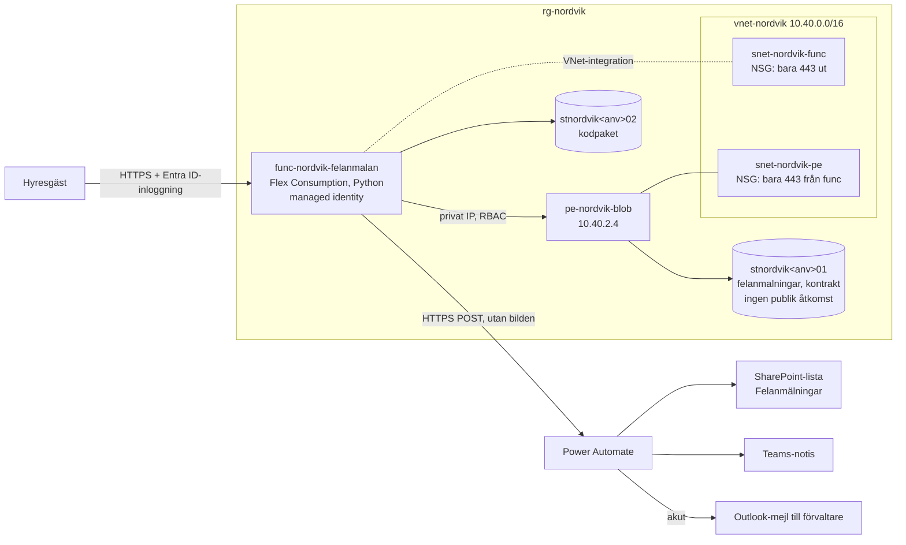
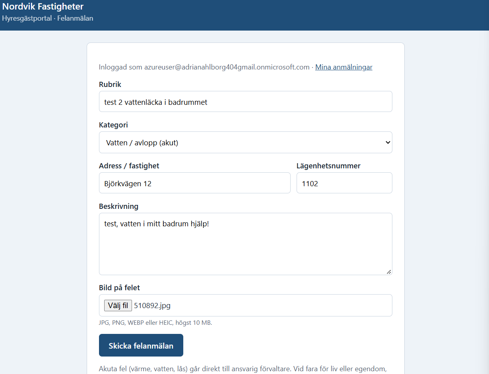
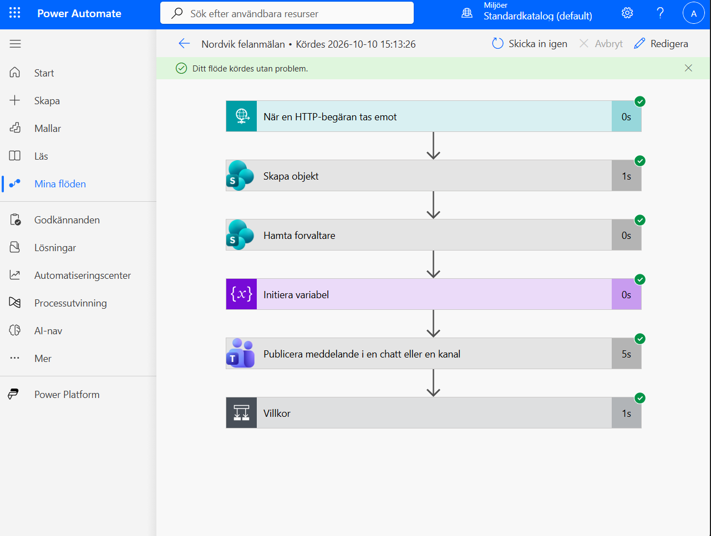
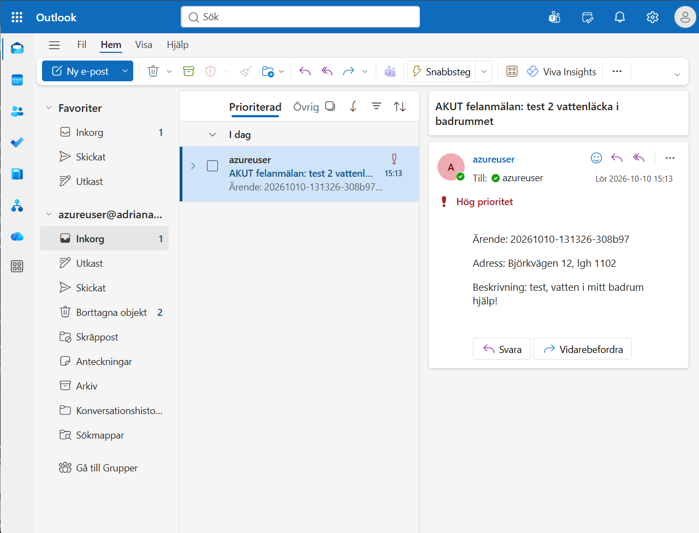

# Nordvik Fastigheter AB – hyresgästportal med felanmälan

Detta Repo är en sammanfattning av https://github.com/adrianahlborg404-png/Azure-novatrix-mov25

En hyresgäst loggar in, fyller i en felanmälan (rubrik, beskrivning och en bild) och skickar in den. Anmälan sparas privat i Azure, hamnar i en SharePoint-lista, ger en notis i Teams och, för akuta kategorier (värme, vatten, lås), ett mejl med hög prioritet till ansvarig förvaltare.

Den här guiden visar hur du sätter upp hela lösningen i din egen Azure-prenumeration och Microsoft 365-tenant. Azure-delen byggs med ett kommando från repot. Microsoft 365-delen tar ungefär 20 minuter att klicka ihop.

> Slutuppgift i kursen Microsoft Azure inom utbildningen Moln- och virtualiseringsspecialist, Campus Mölndal.

**Teknik:** Azure Functions (Flex Consumption) · ARM-templates · Entra ID · Managed identity · VNet · NSG · Private endpoint · Blob Storage · Power Automate · SharePoint · Teams · Outlook · Python · Bash

---

## Innehåll

1. [Arkitektur](#arkitektur)
2. [Så ser det ut](#så-ser-det-ut)
3. [Det här behöver du](#det-här-behöver-du)
4. [Steg 1 – Hämta repot i Cloud Shell](#steg-1--hämta-repot-i-cloud-shell)
5. [Steg 2 – Ställ in parameterfilen](#steg-2--ställ-in-parameterfilen)
6. [Steg 3 – Deploya Azure-delen](#steg-3--deploya-azure-delen)
7. [Steg 4 – Testa portalen](#steg-4--testa-portalen)
8. [Steg 5 – Microsoft 365: Teams och SharePoint](#steg-5--microsoft-365-teams-och-sharepoint)
9. [Steg 6 – Power Automate-flödet](#steg-6--power-automate-flödet)
10. [Steg 7 – Koppla flödet till portalen](#steg-7--koppla-flödet-till-portalen)
11. [Steg 8 – Testa hela kedjan](#steg-8--testa-hela-kedjan)
12. [Test- eller demomiljö](#test--eller-demomiljö)
13. [Felsökning](#felsökning)
14. [Repo-struktur](#repo-struktur)
15. [Designval](#designval)
16. [Avgränsningar](#avgränsningar)
17. [Vad jag lärde mig](#vad-jag-lärde-mig)

---

## Arkitektur



| Resurs | Namn | Syfte |
|---|---|---|
| Resursgrupp | `rg-nordvik` / `rg-nordvik-test` | En per miljö |
| Function App | `func-nordvik-felanmalan-<anv>` | Portalen: formulär, sparande, notis |
| Flex Consumption-plan | `asp-nordvik-felanmalan` | Skalar till noll nattetid, ut vid toppar |
| Storage (data) | `stnordvik<anv>01` | Bilder, anmälningar, kontrakt |
| Storage (host) | `stnordvik<anv>02` | Appens kodpaket, inga personuppgifter |
| VNet + 2 subnät | `vnet-nordvik` | VNet-integration och private endpoint |
| NSG ×2 | `nsg-nordvik-func`, `nsg-nordvik-pe` | Filtrering per subnät |
| Private endpoint + DNS | `pe-nordvik-blob`, `nic-nordvik-pe`, `privatelink.blob.core.windows.net` | Privat väg till datalagringen |
| Budget | `budget-nordvik` | Larm vid 80 % och prognos 100 % |

---

## Så ser det ut


*Hyresgästen är inloggad och fyller i en felanmälan med kategori, adress och bild.*


*Flödet tar emot anmälan, skapar en rad i SharePoint, slår upp förvaltaren och postar i Teams.*


*Akuta kategorier ger dessutom ett mejl med hög prioritet till ansvarig förvaltare.*

---

## Det här behöver du

| Vad | Varför |
|---|---|
| En Azure-prenumeration där du är **Owner** | Templaten skapar rolltilldelningar, och det kräver Owner (eller User Access Administrator) |
| Rätt att skapa **grupper och appregistreringar** i Entra ID | Skriptet skapar `grp-nordvik-forvaltare`, `grp-nordvik-ekonomi` och `app-nordvik-felanmalan` |
| Ett **Microsoft 365-konto** i samma Entra ID-tenant som prenumerationen, med Teams, SharePoint och Outlook | Där hamnar listan, notisen och mejlet. Samma konto används för att logga in i portalen som testhyresgäst |
| **Power Automate med premium-connectors** | Triggern *När en HTTP-begäran tas emot* är premium |

Ett användarnamn behövs också. Det ingår i namn som måste vara unika i hela Azure. Använd ditt skolanvändarnamn eller något kort eget, med 2–13 tecken och bara små bokstäver och siffror.

---

## Steg 1 – Hämta repot i Cloud Shell

Öppna [portal.azure.com](https://portal.azure.com), klicka på ikonen **`>_`** högst upp och välj **Bash**. Får du en fråga om lagring, välj *No storage account required*.

```bash
git clone https://github.com/adrianahlborg404-png/nordvik-hyresgastportal.git
cd nordvik-hyresgastportal
git config core.fileMode false
chmod +x scripts/*.sh
```

`git config core.fileMode false` gör att `chmod` inte syns som en lokal ändring, så att `git pull` fungerar senare.

> **Bra att veta:** Cloud Shell-sessionen är tillfällig. Startar den om ligger du i hemmappen (`~`) och repot kan vara borta. Kör då kommandona ovan igen. Alla `./scripts/...`-kommandon måste köras inifrån mappen `nordvik-hyresgastportal`.

Kontrollera att rätt prenumeration är vald och att namnen är lediga. Byt `DITTNAMN` mot ditt användarnamn:

```bash
az account show --query "{prenumeration:name, konto:user.name}" -o table
az storage account check-name --name stnordvikDITTNAMN01 --query nameAvailable
az storage account check-name --name stnordvikDITTNAMN02 --query nameAvailable
```

Båda ska svara `true`.

---

## Steg 2 – Ställ in parameterfilen

Öppna `infra/azuredeploy.parameters.prod.json` (till exempel med `nano`) och ändra:

| Parameter | Sätt till |
|---|---|
| `anvandarnamn` | Ditt användarnamn |
| `budgetEpost` | Din mejladress för budgetlarm (tom = ingen budget skapas) |
| `budgetBelopp` | 2500 om prenumerationen faktureras i kronor. Faktureras den i dollar (vanligt för Azure for Students), sätt cirka 240 |

Valutan ser du i portalen under **Cost Management → Cost analysis**. Gör samma ändringar i `azuredeploy.parameters.test.json` om du vill kunna resa en testmiljö.

---

## Steg 3 – Deploya Azure-delen

```bash
./scripts/deploy.sh prod
```

1. När skriptet frågar efter **HTTP-URL:en från flödets trigger**, tryck bara **Enter**. Flödet byggs i steg 6.
2. Läs igenom **what-if**-listan. Första gången ska den visa `Resource changes: 25 to create`.
3. Skriv **j** och tryck Enter.
4. Vänta 5–10 minuter tills det står **Klart.**

> **Viktigt:** kör aldrig skriptet två gånger samtidigt. Klistra in kommandot en gång och vänta tills det är klart. Två parallella deployer krockar (*Another operation is pending*).

`deploy.sh` gör följande:

1. Registrerar resursproviders (bland annat `Microsoft.App`, som Flex Consumption kräver).
2. Skapar resursgruppen med taggar.
3. Skapar Entra-grupperna om de saknas.
4. Frågar efter flödets URL. Den är hemlig och committas aldrig.
5. Kör `what-if` och väntar på bekräftelse.
6. Deployar `infra/azuredeploy.json`.
7. Skapar appregistreringen och deployar igen med Entra-inloggning påslagen.
8. Zippar `app/` och deployar koden med remote build.

Verifiera sedan:

```bash
./scripts/verifiera.sh prod
```

Allt ska vara **[OK]** utom *Power Automate-URL är konfigurerad*, eftersom flödet inte är kopplat än.

---

## Steg 4 – Testa portalen

1. Öppna `https://func-nordvik-felanmalan-<anv>.azurewebsites.net/halsa`. Den kräver ingen inloggning.
   - `"lagring": "ok"` betyder att appen når den låsta lagringen.
   - `"lagring": "fel: ..."` betyder att rolltilldelningarna inte har slagit igenom än. Vänta en minut och ladda om.
   - Första anropet kan ta 10–20 sekunder, eftersom appen vaknar från noll instanser.
2. Öppna `.../felanmalan` i ett **inkognitofönster** och logga in med ditt Microsoft 365-konto. Klicka **Accept** om du får en fråga om behörigheter.
3. Gör en testanmälan med en bild. Du ska få ett ärendenummer, och den ska synas under **Mina anmälningar**.

---

## Steg 5 – Microsoft 365: Teams och SharePoint

Logga in med ditt **Microsoft 365-konto** i alla steg nedan.

**Teams**

1. [teams.microsoft.com](https://teams.microsoft.com) → **Teams** → **Skapa team** → *Från grunden* → *Privat* → döp det till **Nordvik Förvaltning**.
2. Klicka **…** vid teamet → **Lägg till kanal** → **Felanmälningar** (Standard).

Teamet får automatiskt en SharePoint-webbplats. Öppna kanalen, välj fliken **Filer** och sedan **Öppna i SharePoint**.

**Listan Felanmälningar.** **+ Ny → Lista → Tom lista**, med namnet `Felanmälningar`. Lägg till kolumnerna exakt så här, utan å, ä och ö:

| Kolumn | Typ |
|---|---|
| ArendeId | En textrad |
| Beskrivning | Flera textrader |
| Kategori | En textrad |
| Akut | Ja/Nej |
| Fastighet | En textrad |
| Lagenhet | En textrad |
| Hyresgast | En textrad |
| Bildsokvag | En textrad |
| Status | Val: Ny, Pågår, Åtgärdad (standard Ny) |
| Inkommen | Datum och tid |

**Listan Fastigheter.** **+ Ny → Lista → Tom lista**, med namnet `Fastigheter`.

- Lägg till kolumnen **Forvaltare** av typen **Person**.
- Lägg till en rad per fastighet med **+ Nytt**, till exempel *Rubrik* = `Björkvägen 12` och *Forvaltare* = ditt konto.

Adressen måste stavas exakt som hyresgästen skriver den i formuläret.

---

## Steg 6 – Power Automate-flödet

Två sätt att få flödet på plats.

### Alternativ A: importera paketet (snabbast)

1. [make.powerautomate.com](https://make.powerautomate.com) → **Mina flöden** → **Importera** → **Importera paket (äldre)**.
2. Ladda upp zip-filen från mappen `flow/` i repot.
3. Under **Relaterade resurser**, välj eller skapa dina egna anslutningar för SharePoint, Teams och Office 365 Outlook.
4. Klicka **Importera** och öppna sedan flödet. Kontrollera i stegen att rätt webbplats, listor, team och kanal är valda. Rätta det som pekar på originalmiljön.
5. Öppna steget **Initiera variabel** och byt reservadressen i uttrycket mot din egen mejladress.

### Alternativ B: bygg flödet själv

Skapa ett **Automatiserat molnflöde**, ge det namnet `Nordvik felanmälan`, klicka **Hoppa över** och lägg till stegen i den här ordningen:

| # | Steg (svenskt gränssnitt) | Inställningar |
|---|---|---|
| 1 | **När en HTTP-begäran tas emot** | *Vem kan utlösa flödet:* **Alla**. Klistra in schemat från [`flow/trigger-schema.json`](flow/trigger-schema.json) |
| 2 | **Skapa objekt** (SharePoint) | Webbplats *Nordvik Förvaltning*, lista *Felanmälningar*. Fält från triggern: Title=`rubrik`, ArendeId=`arendeId`, Beskrivning=`beskrivning`, Kategori=`kategoriNamn`, Akut=`akut`, Fastighet=`fastighet`, Lagenhet=`lagenhet`, Hyresgast=`hyresgastNamn`, Bildsokvag=`bildBlob`, Status=*Ny*, Inkommen=`skapad` |
| 3 | **Hämta objekt** (SharePoint), **döp om till `Hamta_forvaltare`** | Lista *Fastigheter*. *Filterfråga:* `Title eq '` + `fastighet` + `'`. *Högsta antal:* `1` |
| 4 | **Initiera variabel** | Namn `forvaltareEpost`, typ *Sträng*, värde med **fx** (uttrycket nedan) |
| 5 | **Publicera meddelande i en chatt eller kanal** (Teams) | *Flödesrobot*, *Kanal*, team *Nordvik Förvaltning*, kanal *Felanmälningar*. Text med `arendeId`, `rubrik`, `kategoriNamn`, `fastighet`, `lagenhet`, `forvaltareEpost` |
| 6 | **Villkor** | `akut` **är lika med** `true`. Skriv `true` via **fx**, annars blir det text |
| 6a | Under **Sant:** **Skicka ett e-postmeddelande (V2)** | Till=`forvaltareEpost`, ämne `AKUT felanmälan: ` + `rubrik`, prioritet *Hög* |

Uttrycket i steg 4. Byt reservadressen mot din egen:

```
if(empty(body('Hamta_forvaltare')?['value']), 'din.adress@dintenant.onmicrosoft.com', first(body('Hamta_forvaltare')?['value'])?['Forvaltare']?['Email'])
```

Uttrycket pekar på steget med dess namn, och därför måste steg 3 heta exakt `Hamta_forvaltare`.

Mer detaljer finns i [`flow/README.md`](flow/README.md).

---

## Steg 7 – Koppla flödet till portalen

1. Klicka **Spara** i Power Automate.
2. Öppna triggern och kopiera **HTTP-URL**. Ett importerat flöde får alltid en ny URL.
3. Kör i Cloud Shell, inifrån repomappen. Ha enkla citattecken runt URL:en, eftersom den innehåller `&`:

```bash
FLOW_URL='KLISTRA-IN-URL:EN-HÄR' AUTO=1 ./scripts/deploy.sh prod
```

`AUTO=1` hoppar över frågan efter what-if. Kontrollera sedan `/halsa`: där ska stå `"flode": "konfigurerat"`.

> URL:en innehåller en signatur (`sig=...`) som fungerar som ett lösenord. Lägg den aldrig i repot, i dokumentation eller på skärmbilder.

---

## Steg 8 – Testa hela kedjan

Gör en ny anmälan i portalen med kategorin **Vatten / avlopp (akut)** och en adress som finns i listan *Fastigheter*. Inom cirka 30 sekunder ska du se:

| Var | Resultat |
|---|---|
| Kvittot i portalen | Raden *Akut kategori: förvaltaren har fått ett mejl direkt.* |
| SharePoint, *Felanmälningar* | En ny rad: Akut ✓, Status *Ny* |
| Teams, *Felanmälningar* | Ett meddelande från flödesroboten |
| Outlook | Mejlet *AKUT felanmälan: …* med hög prioritet |
| Power Automate, körningshistorik | En körning med alla steg gröna |

Kör sist:

```bash
./scripts/verifiera.sh prod                    # ska ge 9 OK, 0 FEL
./scripts/oversikt.sh prod | tee oversikt.txt  # hela konfigurationen som text
```

`oversikt.txt` kan du ladda ner via **Manage files → Download** i Cloud Shell.

---

## Test- eller demomiljö

Samma template, en annan parameterfil: egen resursgrupp, löpnummer 03/04 och billigare LRS-lagring.

```bash
./scripts/deploy.sh test      # Enter på flödesfrågan, j efter what-if
./scripts/verifiera.sh test
./scripts/ta-bort.sh test     # bekräfta med rg-nordvik-test
```

Entra-grupperna delas mellan miljöerna. Appregistreringen `app-nordvik-felanmalan-test` ligger kvar efter borttagningen.

---

## Felsökning

| Symptom | Orsak och lösning |
|---|---|
| `./scripts/...: No such file or directory` | Du står inte i repomappen. Kör `cd ~/nordvik-hyresgastportal`, eller klona igen om Cloud Shell har startat om. |
| `git pull`: *Your local changes … would be overwritten* | `chmod` syns som en ändring. Kör `git config core.fileMode false && git checkout -- . && git pull`. |
| `/halsa` visar `"lagring": "fel: ..."` | Rolltilldelningarna har inte slagit igenom. Vänta några minuter och ladda om. |
| Deployen misslyckas med *Another operation is pending* | Två deployer körs samtidigt. Vänta tills den andra är klar och kör om. Templaten är idempotent. |
| `"flode": "saknas"` på `/halsa` | Kör steg 7 med `FLOW_URL=...`. |
| Anmälan sparas men ingen notis kommer | Kolla körningshistoriken i Power Automate. Kommer ingen körning alls, sätt `"natGateway": true` i parameterfilen och deploya igen. Det ger appen en egen utgående väg till internet. |
| Mejlet går till reservadressen | Adressen i formuläret matchar ingen rad i *Fastigheter*. Stavningen måste vara exakt. |
| Inloggningen säger att appen saknas eller nekar | Logga in med ett konto i samma Entra ID-tenant som prenumerationen, i ett inkognitofönster. |
| Lagringskontot visar *access denied* i portalen | Det är rätt: lagringen är stängd för internet. Vill du titta själv, sätt din publika IP i parametern `adminIpAdress` tillfälligt. |

---

## Repo-struktur

```
infra/
  azuredeploy.json                  ARM-template för hela miljön
  azuredeploy.parameters.prod.json  parametrar för prod
  azuredeploy.parameters.test.json  parametrar för test/demo
app/
  function_app.py                   portalen (formulär, sparande, notis, mina anmälningar, hälsokontroll)
  host.json, requirements.txt
flow/
  README.md                         flödet steg för steg
  trigger-schema.json               JSON-schema för flödets HTTP-trigger
  Powerautomateflow-…zip            exporterat flödespaket
scripts/
  deploy.sh                         återskapar Azure-delen från repot
  verifiera.sh                      kontrollerar delmomenten (OK/FEL)
  oversikt.sh                       skriver ut hela konfigurationen som text
  ta-bort.sh                        tar bort en miljö
docs/
  oversikt.txt                      utdata från oversikt.sh för prod, 2026-10-10
  bilder/                           skärmdumpar till README
```

---

## Designval

**Compute (serverless).** Trafiken är nära noll mellan 00 och 06, normalt 5–10 samtidiga användare men upp mot 120, och en vattenläcka kan ge över 300 anmälningar på en timme. Flex Consumption skalar till noll när ingen använder portalen och skalar ut automatiskt vid toppar. En VM-lösning som klarar instansbortfall hade krävt minst två VM:ar och en lastbalanserare dygnet runt.

**IAM (least privilege).**

| Vem | Behörighet | Omfång |
|---|---|---|
| Portalens managed identity | Storage Blob Data Contributor | Bara containern `felanmalningar` |
| Portalens managed identity | Storage Blob Data Owner | Bara sin egen hostlagring |
| `grp-nordvik-forvaltare` | Storage Blob Data Contributor | Datalagringen; redigera i SharePoint-listan |
| `grp-nordvik-ekonomi` | Storage Blob Data Reader + Cost Management Reader | Containern `kontrakt` + resursgruppen; läsa i SharePoint-listan |
| Hyresgäst | Ingen Azure-roll | Skapar och ser bara sina egna anmälningar (sparas under sitt objekt-ID) |

**Nätverk och säkerhet (defense in depth).**

| Lager | Åtgärd |
|---|---|
| Identitet | Entra ID-inloggning, managed identity, inga åtkomstnycklar (`allowSharedKeyAccess: false`) |
| Applikation | Bara HTTPS, TLS 1.2, FTP av, kontroll av filtyp och storlek, HTML-escaping |
| Nätverk | Datalagringen nås bara via private endpoint; NSG på båda subnäten, bara port 443 |
| Data | Ingen publik blobåtkomst, kryptering i vila, mjuk radering 14 dagar, radering av anmälningar efter tre år |
| Hemligheter | Flödets URL är en `securestring` som skickas in vid deploy och aldrig hamnar i repot |

**Storage.** Anmälningar sparas som `felanmalningar/<hyresgästens-id>/<ärende>/bild.jpg` och `anmalan.json`. Kontrakt ligger i `kontrakt/` och flyttas till Cool efter 90 dagar. Datalagringen är ZRS i prod.

**Kostnad och taggar.** Function-appen kostar bara när den används. De fasta kostnaderna är främst private endpoint och lagring. NAT gateway och zonredundant plan finns som parametrar men är avstängda som standard. Budgeten larmar vid 80 % och vid prognos över 100 %. Alla resurser taggas med `foretag`, `projekt`, `miljo`, `avdelning`, `fastighet` och `skapad-av`.

## Avgränsningar

- Hyresgäster är testkonton i den egna tenanten. I verklig drift används Entra External ID.
- SharePoint-listor och flödet skapas i portalen. Flödet versionshanteras som exporterat paket i `flow/`.
- Förvaltarna hanterar ärenden i SharePoint-listan, inte i portalen.
- Ingen Application Insights. Övervakning sker via `/halsa` och plattformens loggar.

---

## Vad jag lärde mig

**Att bygga allt som kod tvingade mig att förstå hur delarna hänger ihop.** En private endpoint räcker inte ensam: den behöver en privat DNS-zon, en länk till VNet:et och en zongrupp innan namnet pekar på rätt IP. Flex Consumption kräver ett delegerat subnät och en egen resursprovider. I portalen hade det mesta skett i bakgrunden, men i ARM-templaten måste varje del finnas med.

**Att säkerheten styr designen.** När lagringen låstes bakom en private endpoint kunde Power Automate inte längre nå den. Därför skickar portalen uppgifterna till flödet i stället för att flödet hämtar dem. Med managed identity och `allowSharedKeyAccess: false` finns det heller inga nycklar som kan läcka.

**Att least privilege är mer arbete men gör lösningen begriplig.** Varje roll har ett skäl och ett så litet omfång som möjligt, ner till en enskild container. Det gör det lätt att förklara vem som får göra vad.

**Att felsöka genom att läsa felet och verifiera med skript.** Två deployer samtidigt gav en konflikt på DNS-zonen, och ett nätverkskort fick ett autogenererat namn tills jag satte namnet i templaten. När rolltabellen i `verifiera.sh` kom tillbaka tom visade det sig att Azure skriver resursgruppens namn med små bokstäver i sökvägen, så filtret behövde ändras. Att kontrollera med kod i stället för att klicka runt i portalen gick både snabbare och säkrare.

**Att parametrar gör miljön återskapbar.** Med en parameterfil per miljö kunde jag bygga en likadan testmiljö, verifiera den och riva den igen med två kommandon.

**Att uppgiften är en del av en större kedja.** I verklig drift hade hyresgästerna loggat in via Entra External ID och kopplats till sin lägenhet, och deployen hade skett via en pipeline med övervakning. Projektet täcker plattformen som allt det vilar på.
