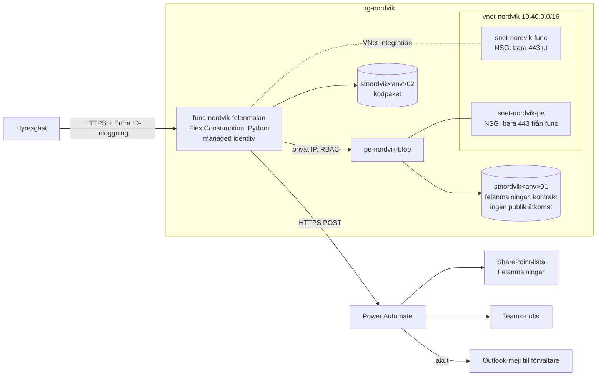

# Nordvik Fastigheter AB – hyresgästportal med felanmälan

Slutuppgift (uppgift 8, v41) i kursen Microsoft Azure. En hyresgäst loggar in, fyller i en felanmälan (rubrik, beskrivning och en bild) och skickar in den. Anmälan sparas privat i Azure, hamnar i en SharePoint-lista, ger en notis i Teams och, för akuta kategorier (värme, vatten, lås), ett mejl direkt till ansvarig förvaltare.

Hela Azure-miljön beskrivs som kod i `infra/` och kan återskapas från repot med ett kommando.

## Arkitektur



| Resurs | Namn | Syfte |
|---|---|---|
| Resursgrupp | `rg-nordvik` / `rg-nordvik-test` | En per miljö |
| Function App | `func-nordvik-felanmalan-<anv>` | Portalen: formulär, sparande, notis |
| Flex Consumption-plan | `asp-nordvik-felanmalan` | Skalar till noll nattetid, ut vid toppar |
| Storage (data) | `stnordvik<anv>01` | Bilder, anmälningar, kontrakt |
| Storage (host) | `stnordvik<anv>02` | Appens kodpaket, inga personuppgifter |
| VNet + 2 subnät | `vnet-nordvik` | VNet-integration och private endpoint |
| NSG ×2 | `nsg-nordvik-func`, `nsg-nordvik-pe` | Filtrering per subnät |
| Private endpoint + DNS | `pe-nordvik-blob`, `privatelink.blob.core.windows.net` | Privat väg till datalagringen |
| Budget | `budget-nordvik` | Larm vid 80 % / prognos 100 % |

## Återskapa miljön

Kör i Azure Cloud Shell (Bash), som redan har `az`, `jq` och `zip`:

```bash
git clone https://github.com/<ditt-konto>/<repo>.git
cd <repo>
# 1. Sätt ditt användarnamn (och gärna budgetEpost) i parameterfilen
nano infra/azuredeploy.parameters.prod.json
# 2. Bygg flödet enligt flow/README.md och kopiera dess HTTP-URL
# 3. Deploya allt
chmod +x scripts/*.sh
./scripts/deploy.sh prod
# 4. Verifiera
./scripts/verifiera.sh prod
```

En likadan test- eller demomiljö: `./scripts/deploy.sh test` (egen resursgrupp, eget löpnummer, LRS i stället för ZRS). Ta bort den efteråt med `./scripts/ta-bort.sh test`.

`deploy.sh` gör följande, i ordning:
1. Registrerar resursproviders (bl.a. `Microsoft.App`, som Flex Consumption kräver).
2. Skapar resursgruppen med taggar.
3. Skapar Entra-grupperna `grp-nordvik-forvaltare` och `grp-nordvik-ekonomi` om de saknas.
4. Frågar efter flödets URL (hemlig, committas aldrig).
5. Kör `what-if` och väntar på bekräftelse.
6. Deployar `infra/azuredeploy.json`.
7. Skapar appregistreringen för Entra-inloggning och deployar igen med inloggning påslagen.
8. Zippar `app/` och deployar koden med remote build.

## Repo-struktur

```
infra/
  azuredeploy.json                  ARM-template för hela miljön
  azuredeploy.parameters.prod.json  parametrar för prod
  azuredeploy.parameters.test.json  parametrar för test/demo
app/
  function_app.py                   portalen (formulär, sparande, notis, mina anmälningar, hälsokontroll)
  host.json, requirements.txt
flow/
  README.md                         Power Automate-flödet steg för steg
  trigger-schema.json               JSON-schema för flödets HTTP-trigger
scripts/
  deploy.sh                         återskapar allt från repot
  verifiera.sh                      kontrollerar delmomenten
  ta-bort.sh                        tar bort en miljö
```

## Designval

**Compute (serverless).** Trafiken är nära noll mellan 00 och 06, normalt 5–10 samtidiga användare men upp mot 120, och en vattenläcka kan ge över 300 anmälningar på en timme. Flex Consumption skalar till noll när ingen använder portalen och skalar ut automatiskt vid toppar. Faller en instans bort startar plattformen en ny. En VM-lösning som klarar instansbortfall hade krävt minst två VM:ar och en lastbalanserare dygnet runt, alltså kapacitet som står oanvänd på natten.

**IAM (least privilege).**

| Vem | Behörighet | Omfång |
|---|---|---|
| Portalens managed identity | Storage Blob Data Contributor | Bara containern `felanmalningar` |
| Portalens managed identity | Storage Blob Data Owner | Bara sin egen hostlagring |
| `grp-nordvik-forvaltare` | Storage Blob Data Contributor | Datalagringen; Redigera i SharePoint-listan |
| `grp-nordvik-ekonomi` | Storage Blob Data Reader + Cost Management Reader | Containern `kontrakt` + resursgruppen; Läsa i SharePoint-listan |
| Hyresgäst | Ingen Azure-roll | Loggar in i portalen och ser bara sina egna anmälningar (sparas under sitt eget objekt-ID) |

**Nätverk och säkerhet (defense in depth).**

| Lager | Åtgärd |
|---|---|
| Identitet | Entra ID-inloggning i portalen, managed identity mot lagringen, inga åtkomstnycklar (`allowSharedKeyAccess: false`) |
| Applikation | Bara HTTPS, TLS 1.2, FTP avstängt, validering av filtyp och storlek, HTML-escaping |
| Nätverk | Datalagringen har publik åtkomst avstängd och nås bara via private endpoint; NSG på båda subnäten |
| Data | Ingen publik blobåtkomst, kryptering i vila, mjuk radering 14 dagar, radering av anmälningar efter tre år |
| Uppföljning | Taggar på alla resurser, budgetlarm, hälsokontroll på `/halsa` |

**Storage.** Anmälningar sparas som `felanmalningar/<hyresgästens-id>/<ärende>/bild.jpg` och `anmalan.json`. Kontrakt och protokoll ligger i `kontrakt/` och flyttas automatiskt till Cool efter 90 dagar, eftersom de sällan läses efter de tre första månaderna. Datalagringen är ZRS i prod.

**Kostnad.** Riktvärdet är 2 500 kr/mån. Function-appen kostar bara när den används. De fasta kostnaderna är främst private endpoint och lagring. NAT gateway och zonredundant plan finns som parametrar men är avstängda som standard för att hålla kostnaden nere. Budgeten i templaten larmar innan riktvärdet passeras. Ange beloppet i prenumerationens valuta.

**Taggar.** `foretag`, `projekt`, `miljo`, `avdelning`, `fastighet`, `skapad-av` på alla resurser. Portalen delas av alla fastigheter och taggas därför `fastighet=gemensam`.

## Avgränsningar

- Hyresgäster loggar in som användare i Nordviks Entra ID-tenant (testkonton i demon). I verklig drift med 5 500 hyresgäster skulle Entra External ID användas.
- SharePoint-listorna och Power Automate-flödet skapas i portalen enligt `flow/README.md`. Flödet exporteras och versionshanteras som paket i `flow/`.
- Förvaltarnas ärendehantering sker i SharePoint-listan, inte i portalen.
- Application Insights ingår inte. Loggning sker via Functions-plattformens loggar och hälsokontrollen.
